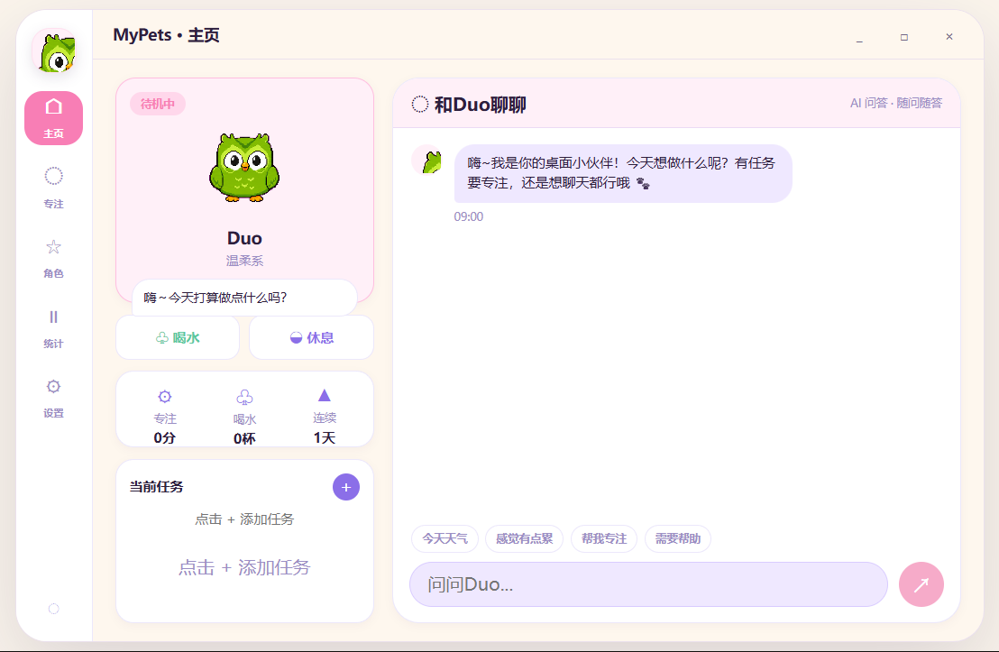
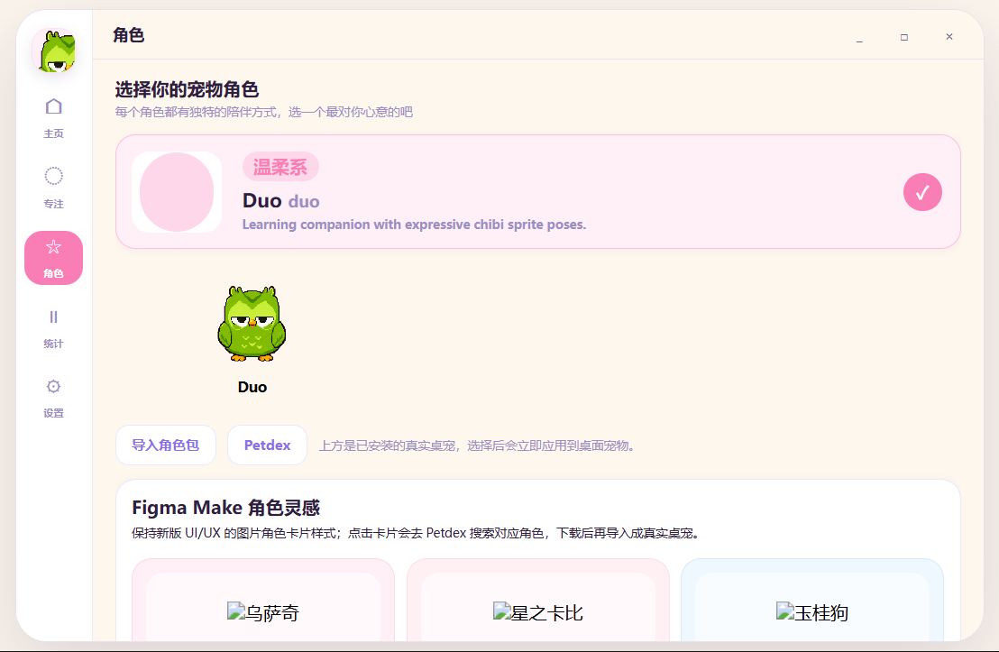

# MyPets · AI 桌面陪伴与专注助手

把提醒、专注和 AI 问答放进一只常驻桌面的宠物里。面向长时间学习、办公的人，探索更轻量、有反馈的效率工具。

[下载 Windows 体验版](https://github.com/FUllllll910/MyPets/releases) · [实际应用演示](docs/demo/mypets-author-demo.mp4) · [产品思考与实现](docs/MyPets-Portfolio.md)



## 先看演示

以下为项目作者亲自录制的 MyPets 实际使用演示。点击下方封面或视频链接观看。

[](https://github.com/FUllllll910/MyPets/blob/main/docs/demo/mypets-author-demo.mp4)

**[▶ 观看演示视频（MP4）](https://github.com/FUllllll910/MyPets/blob/main/docs/demo/mypets-author-demo.mp4)** · [下载原视频](https://github.com/FUllllll910/MyPets/raw/refs/heads/main/docs/demo/mypets-author-demo.mp4)

封面为应用截图。若 GitHub 未显示播放器，可点击「下载原视频」在本地播放。

## 项目定位与贡献边界

这是基于开源 [PawPause](https://github.com/angziii/PawPause) 迭代的个人作品，保留原项目的桌宠、提醒和平台集成基础。当前迭代重点是 MyPets 品牌与信息架构、五页式界面、角色展示与 GIF 自定义、DeepSeek 兼容聊天链路，以及 AI 产品评估设计。不是从零实现 Electron 框架或训练大模型。

## 可以体验什么

| 场景 | 实现 |
| --- | --- |
| 桌面陪伴 | 透明置顶、拖动、漫游与宠物动画状态 |
| 专注与习惯 | 专注计时、休息、喝水、自定义提醒和统计 |
| 个性化 | 角色选择、按状态导入 GIF、大小及气泡偏好 |
| AI 问答 | 连续点击宠物三次打开聊天，调用 DeepSeek 兼容接口 |
| 时效性问题 | 关键词路由；天气尝试 wttr.in，其他实时问题尝试 DuckDuckGo Instant Answer，失败提供兜底 |
| 状态反馈 | 请求中、成功、失败与桌宠状态联动 |



## 运行与下载

Windows 体验包在 Releases 中，解压整个文件夹后打开 `MyPets.exe`，不要单独移动 EXE。当前发布未做商业代码签名。

开发环境：Node.js 22、pnpm 10.33.2。

```bash
git clone https://github.com/FUllllll910/MyPets.git
cd MyPets
corepack pnpm install --frozen-lockfile
corepack pnpm dev
```

配置聊天（PowerShell，Key 仅在本机输入，不要提交）：

```powershell
$env:MYPETS_DEEPSEEK_API_KEY="你的 Key"
# 可选：设置你账号实际可用的模型 ID
$env:MYPETS_DEEPSEEK_MODEL="你的模型 ID"
corepack pnpm dev
```

可选 `MYPETS_DEEPSEEK_BASE_URL` 配置兼容服务。当前 1.0.9 读取环境变量，**没有设置页填写 Key 的入口**。聊天会把输入和上下文发送至配置的服务；在线信息功能还会访问上述第三方来源。

macOS 保留构建配置，但本次没有在真实 Mac 上验证或发布新版 Mac 安装包。此前版本的 Mac 测试包不代表本次版本。

## 实现结构

```text
React 界面 / 桌宠交互
        ↓ preload 暴露的 IPC API
Electron 主进程
        ├─ 设置、统计、提醒与窗口管理
        ├─ 聊天 Prompt / 上下文 / HTTP 请求 / 错误处理
        └─ 宠物动作、气泡及平台能力
```

| 路径 | 用途 |
| --- | --- |
| `src/main` | 主进程、持久化、平台与模型调用 |
| `src/preload` | 渲染进程与主进程通信桥 |
| `src/renderer` | React + TypeScript 界面 |
| `src/shared` | 类型、语言和共用配置 |
| `evals` / `scripts/evaluate-pet-chat.mjs` | 五类聊天用例与人工评分维度 |
| `docs/demo` | 本次应用录屏与截图 |

## 验证与已知边界

2026-11-12：TypeScript 检查与生产构建通过；实际 Electron 界面五页切换录屏完成。`pnpm eval:chat` 可输出五条用例与评分规则，**它不是自动化模型质量测试，也没有生成效果提升数据**。本次没有使用真实 API Key 做付费模型调用，没有宣称线上用户量、留存率或 A/B 实验结果。

```bash
corepack pnpm build
corepack pnpm eval:chat
corepack pnpm dist:win
```

- 部分分心检测及系统集成仅支持 macOS；Windows 不代表这些能力已验证。
- 在线上下文是轻量信息补充，并非完整搜索引擎或 RAG 知识库。
- 后续重点：真实 Mac 验证、连接配置界面、更多错误恢复测试、人工标注的模型评估结果。

## 来源与素材

源代码遵循 [MIT License](LICENSE)。保留上游贡献归属。宠物图片、GIF 与第三方角色**不自动适用代码 MIT 许可**；详见 [素材说明](ASSET_LICENSE.md)。本仓库作为个人学习与作品展示，商业分发前需核实对应素材授权。
