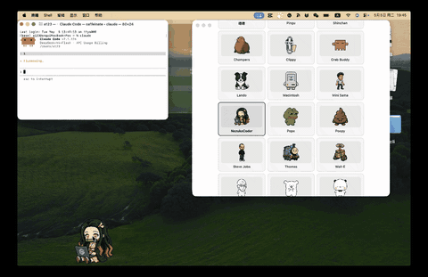

<p align="center">
  
</p>

<h1 align="center">MyPets</h1>

<p align="center">
  A local-first AI desktop pet for focus, reminders, custom GIF personas, and DeepSeek chat.
</p>

<p align="center">
  <a href="docs/GLOSSARY.md">Glossary / 术语表</a> ·
  <a href="docs/readme/README.zh-CN.md">简体中文</a>
</p>

MyPets is a desktop companion for macOS and Windows. It keeps a small interactive pet on screen, reminds users to rest and drink water, supports focus nudges, lets users upload GIFs for different pet states, and opens an AI chat bubble after triple-clicking the pet.

## Features

- Transparent, always-on-top, draggable desktop pet.
- Break, hydration, focus, and custom daily reminders.
- Custom GIF persona states for idle, movement, thinking, failure, review, and break countdowns.
- Triple-click AI chat powered by DeepSeek-compatible chat completion APIs.
- Lightweight online context for time-sensitive questions such as weather.
- Local Codex, Claude Code, OpenCode, DeepSeek TUI, and Hermes activity alerts.
- Local-first settings, stats, imported pets, and chat UI state.

## Local Development

```bash
corepack enable
pnpm install
pnpm dev
```

If Electron reports that it is uninstalled, reinstall dependencies:

```bash
pnpm install
```

## DeepSeek Chat

Set an API key before starting the app:

```powershell
$env:DEEPSEEK_API_KEY="your DeepSeek API key"
pnpm.cmd dev
```

Project-specific variables are also supported:

```powershell
$env:MYPETS_DEEPSEEK_API_KEY="your DeepSeek API key"
$env:MYPETS_DEEPSEEK_MODEL="deepseek-chat"
$env:MYPETS_DEEPSEEK_BASE_URL="https://api.deepseek.com"
pnpm.cmd dev
```

## AI Product Evaluation

MyPets includes an offline evaluation set for pet chat behavior:

```bash
pnpm eval:chat
```

The rubric scores intent recognition, grounding, usefulness, pet tone, and safety fallback. See [AI_PRODUCT_ITERATION.md](docs/AI_PRODUCT_ITERATION.md) for product-chain analysis, badcases, and resume-ready project framing.

## Build

```bash
pnpm build
```

## Interview Boundary

Defensible claims: desktop AI pet prototype, DeepSeek integration, online context injection, custom GIF state system, offline eval set, badcase-driven iteration plan.

Do not claim production launch, user growth, AB testing, or commercial impact unless you have measured evidence.
