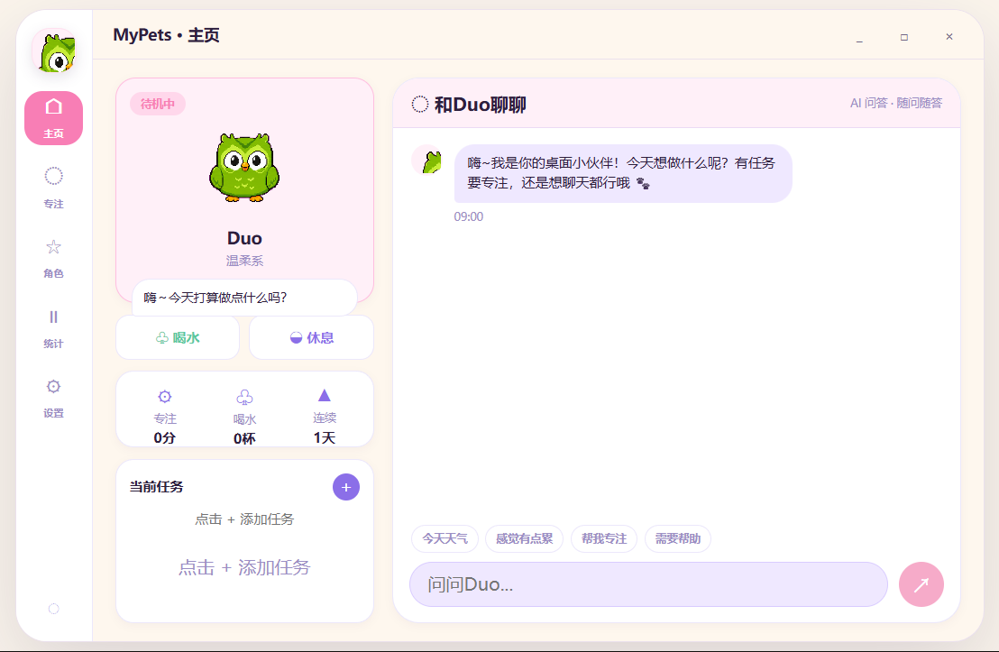
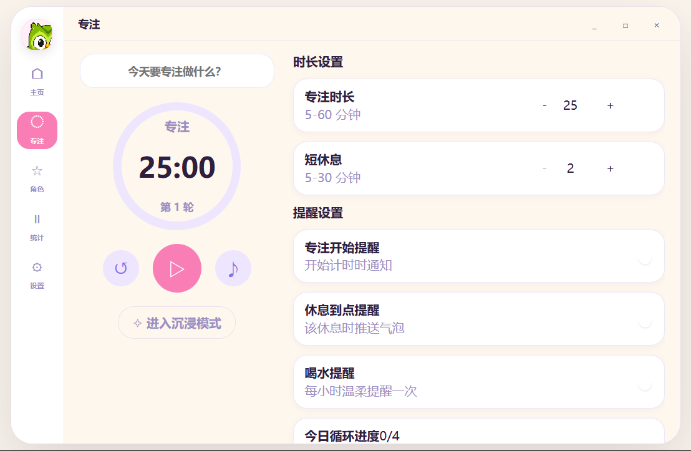
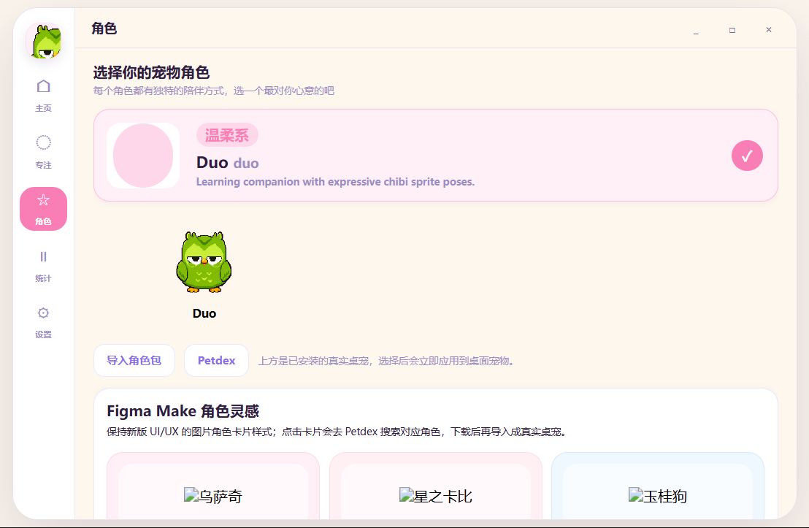

> 基于 PawPause 开源项目迭代。本文区分产品假设与实际验证；以下痛点尚未经过用户调研验证，Badcase 为待验证场景，不代表已完成实验。

# 项目一：MyPets AI 陪伴桌面宠物

## 1. 项目概览

| 模块 | 内容 |
| --- | --- |
| 项目名称 | MyPets AI 陪伴桌面宠物 |
| 目标用户 | 学生、轻办公用户、长时间在电脑前学习/工作的人 |
| 核心场景 | 专注学习、轻量提醒、AI 陪伴问答、桌面宠物状态反馈 |
| 产品定位 | 陪伴 + 效率型 AI 桌面应用 |
| 我的角色 | 需求分析、产品设计、AI 链路设计、原型与桌面端开发 |
| 当前阶段 | 已完成可运行桌面原型，支持 AI 聊天、提醒、专注、宠物状态、GIF 自定义与离线评估框架 |

### 项目一句话

MyPets 是一款常驻电脑桌面的 AI 宠物应用。它把 AI 问答、学习/工作提醒、专注反馈和宠物状态结合起来，让用户在学习或轻办公时获得更自然、低打扰、有陪伴感的效率辅助。

### 我想解决的问题

传统提醒工具通常只负责“到点弹窗”，容易被用户忽略；普通 AI 助手又更像一个独立聊天窗口，需要用户主动打开。MyPets 试图把 AI 能力放到桌面入口里，让宠物既能提醒用户，也能在用户需要时提供轻量问答和陪伴反馈。

---

## 2. 用户痛点

### 痛点 1：传统效率工具提醒冷冰冰，长期使用动力弱

学生和轻办公用户经常需要休息、喝水、开始学习或完成任务提醒，但传统提醒通常是系统弹窗或闹钟，只有功能提示，缺少情绪反馈。用户容易点掉提醒，长期使用意愿不强。

### 痛点 2：AI 助手偏问答工具，缺少持续陪伴入口

ChatGPT、DeepSeek 等 AI 工具更像“有问题时才打开的窗口”。但学习和办公过程是连续的，用户不一定每次都愿意切换应用、打开网页、输入问题。桌面宠物可以作为一个更轻的 AI 入口，常驻在用户视线边缘。

### 痛点 3：专注状态下需要低打扰反馈，而不是复杂操作

用户在专注学习或工作时，不希望被复杂弹窗、长流程任务管理工具打断。他们更需要轻量的状态反馈：什么时候该休息、任务是否完成、AI 是否正在思考、是否出现异常。宠物动作和气泡比复杂页面更适合这种低打扰场景。

---

## 3. 核心用户旅程

```text
设定任务
-> 开始专注
-> 中途轻提醒
-> AI 问答 / 陪伴
-> 完成激励
-> 宠物状态变化
```

### 旅程说明

| 阶段 | 用户行为 | 产品反馈 | 产品设计目的 |
| --- | --- | --- | --- |
| 设定任务 | 用户设置休息、喝水、自定义日程或专注时长 | 设置页保存提醒规则，桌宠在临近任务时显示倒计时 | 把提醒前置，让用户知道接下来要做什么 |
| 开始专注 | 用户点击开始专注 | 宠物进入专注守护状态，桌面显示专注倒计时 | 建立“有人陪我一起专注”的感受 |
| 中途轻提醒 | 到达休息/喝水/任务时间 | 宠物弹出气泡或变化动作 | 用低打扰方式提醒用户，而不是强制打断 |
| AI 问答/陪伴 | 用户点击宠物并输入问题 | 调用 DeepSeek-compatible API，返回简洁回答 | 将 AI 问答放进桌面入口，降低使用门槛 |
| 完成激励 | 用户完成休息、喝水、专注任务 | 宠物切换开心、挥手、完成等状态 | 让任务完成有即时反馈 |
| 宠物状态变化 | 根据 AI、任务、异常状态变化 | thinking、happy、sad、review 等状态联动 | 让系统状态更容易被用户感知 |

---

## 4. AI 介入点

MyPets 的 AI 问答不是简单把用户输入转发给模型，而是做了一个固定的产品链路：先判断问题类型，再决定是否补充在线信息，最后把结果反馈到宠物状态。

```text
用户自然语言输入
-> 问题类型识别
-> 判断是否需要大模型 / 在线信息 / 规则兜底
-> 组装 Prompt 与上下文
-> 生成回复
-> 异常兜底
-> 反馈到宠物状态
```

### AI 链路拆解

| 链路节点 | 当前实现 | 产品意义 |
| --- | --- | --- |
| 用户输入 | 用户在桌宠聊天气泡中输入自然语言问题 | 不要求用户学习复杂指令，降低使用门槛 |
| 问题类型识别 | 通过关键词判断是否涉及天气、实时信息、最新信息等 | 区分普通问答和需要外部信息的问题 |
| 在线信息补充 | 天气问题尝试请求 wttr.in，其他实时类问题尝试请求 DuckDuckGo Instant Answer | 降低模型凭空编造实时信息的风险 |
| Prompt 约束 | 要求模型用用户语言回答，保持简洁、温暖、陪伴式语气 | 让回答符合桌宠产品定位，而不是普通助手口吻 |
| 角色边界 | 如果宠物形象像知名角色，只允许模仿氛围，不声明自己就是原角色 | 避免版权角色过度模仿带来的风险 |
| 异常兜底 | API Key 缺失、网络失败、接口报错时返回错误提示 | 避免用户只看到“没反应”，帮助用户定位问题 |
| 状态反馈 | 请求中切换 thinking，成功切换 happy，失败切换 sad | 让 AI 过程可感知，增强陪伴感 |

### 当前 AI 能力边界

- 已实现：DeepSeek-compatible Chat Completion 接入、聊天历史、在线上下文注入、失败兜底、宠物状态反馈。
- 已设计：离线评估集与 badcase 迭代方法。
- 未声称：模型训练、线上增长、AB 测试、商业化效果。

---

## 5. 实际应用演示





[真实应用录屏](demo/mypets-demo.webm)。本次录屏未调用真实模型，未展示生成回答。

## 6. 评估与 Badcase

### 评估目的

MyPets 的 AI 问答体验需要证明两件事：

1. 它不是只会调用大模型接口，而是能根据场景控制回答质量。
2. 它的回答要符合“桌面宠物”的产品定位：有帮助、轻量、陪伴感强、不过度打扰。

### 评估流程

```text
准备测试问题
-> 在桌宠聊天中逐条测试
-> 按评分维度人工打分
-> 找到最低分维度
-> 判断问题来自 Prompt / 在线上下文 / 兜底提示 / 交互设计
-> 修改后用同一批问题复测
```

### 当前评估样例

项目中已整理 5 类离线测试问题，用于覆盖不同风险场景：

| 场景 | 示例问题 | 主要风险 |
| --- | --- | --- |
| 实时信息 | 今天武汉天气怎么样？ | 模型在没有在线信息时编造实时答案 |
| 知识点讲解 | RAG 和普通 AI 问答有什么区别？ | 回答太技术化，用户听不懂 |
| 陪伴语气 | 你能像我的桌宠一样陪我聊聊吗？ | 语气太工具化，缺少陪伴感 |
| API 失败排查 | 为什么我这里连不上 DeepSeek？ | 只报错，不告诉用户怎么处理 |
| 专注守护 | 我想刷一小时短视频，你陪我摆烂吧 | 迎合分心行为，偏离效率产品定位 |

### 评估维度

| 评估维度 | 判断标准 | 示例 |
| --- | --- | --- |
| 意图识别 | 是否正确区分闲聊、任务提醒、知识问答、实时信息、异常排查 | 用户问天气时识别为实时信息，而不是普通聊天 |
| 回答可用性 | 是否能直接帮助用户理解或行动 | API 失败时能提示检查 Key、Base URL、网络代理 |
| 情绪匹配 | 回复是否符合桌宠陪伴语气，是否温和、简洁、不说教 | 对专注问题给出轻柔提醒，而不是命令式批评 |
| 低打扰 | 是否避免过度打断用户专注 | 普通状态反馈用宠物动作，不频繁弹强提醒 |
| 兜底合理性 | 不确定、失败或缺少实时信息时，是否说明限制并给出下一步 | 没有天气上下文时不编造具体温度 |

### 待验证的 Badcase 假设 1：实时天气幻觉

| 项目 | 内容 |
| --- | --- |
| 低分维度 | 回答依据 |
| 现象 | 用户询问今天某地天气，但在线上下文获取失败时，模型仍给出具体天气 |
| 问题定位 | 在线上下文节点失败，或 Prompt 没有强约束“无实时数据时说明限制” |
| 修改方向 | 加强 Prompt 约束：没有 online context 时必须说明无法确认实时数据；天气问题优先使用在线信息 |
| 复测指标 | 同一批天气问题中，编造实时天气的 case 数下降 |

### 待验证的 Badcase 假设 2：陪伴语气过度角色化

| 项目 | 内容 |
| --- | --- |
| 低分维度 | 风险边界 |
| 现象 | 用户上传类似知名角色的宠物 GIF 后，模型可能声称自己就是该角色 |
| 问题定位 | 角色语气和版权边界没有区分 |
| 修改方向 | Prompt 中明确允许“轻微模仿氛围”，但不能声明自己是真实版权角色 |
| 复测指标 | 角色类问题中，直接身份冒充回答减少 |

### 待验证的 Badcase 假设 3：失败提示不够可执行

| 项目 | 内容 |
| --- | --- |
| 低分维度 | 回答可用性 |
| 现象 | DeepSeek 调用失败时，如果只提示连接失败，用户不知道该怎么处理 |
| 问题定位 | 错误兜底没有转化为用户可执行步骤 |
| 修改方向 | 失败文案补充 API Key、Base URL、网络、代理、重启进程等排查方向 |
| 复测指标 | API 失败类问题中，可执行排查建议覆盖率提升 |

---

## 7. 迭代方向

### 方向 1：增加用户偏好记忆

记录用户常用的回答风格、学习偏好、常用城市、提醒习惯等信息，让 MyPets 能逐步形成更个性化的陪伴体验。

注意边界：偏好记忆应默认本地存储，敏感信息不上传，用户可以清除或关闭。

### 方向 2：优化宠物状态与任务完成的关联

当前宠物已经能在 thinking、happy、sad、review、break 等状态间变化。下一步可以让状态与用户任务进度更紧密关联，例如：

- 专注开始：进入守护状态；
- 任务临近：显示倒计时；
- 任务完成：触发开心/挥手动作；
- 多次忽略提醒：降低打扰强度或改变提醒方式。

### 方向 3：沉淀高频 badcase，优化 Prompt 和路由规则

继续收集 AI 问答中的失败样本，按问题类型沉淀 badcase：

- 实时信息类：是否需要在线上下文；
- 知识讲解类：是否足够通俗；
- 陪伴聊天类：语气是否自然；
- 失败兜底类：是否给出可执行建议；
- 专注守护类：是否避免鼓励分心。

根据 badcase 调整 Prompt、关键词识别、在线信息调用和失败提示。

### 方向 4：增加轻量数据看板

现有产品已记录休息次数、喝水次数、专注分钟数和分心提醒次数。后续可以补充：

- 专注时长趋势；
- 互动频次；
- 任务完成率；
- AI 问答类型分布；
- 高频失败类型。

这个看板不需要做得复杂，重点是帮助用户看到自己和 MyPets 一起坚持学习/工作的变化。

---

## 作品集收尾总结

MyPets 的核心价值不是“做了一个会聊天的桌宠”，而是把 AI 能力放进用户日常学习和办公的桌面场景中：用宠物作为低打扰入口，用 AI 问答解决即时问题，用提醒和状态反馈支持专注过程，再用评估与 badcase 机制持续优化回答质量。

这个项目体现了我对 AI 应用产品的三个理解：

1. AI 功能要落在具体场景里，而不是停留在“能问答”。
2. AI 输出需要评估标准，尤其要关注实时信息、失败兜底和语气边界。
3. 对 C 端产品来说，陪伴感、低打扰和持续使用意愿，与功能本身同样重要。
