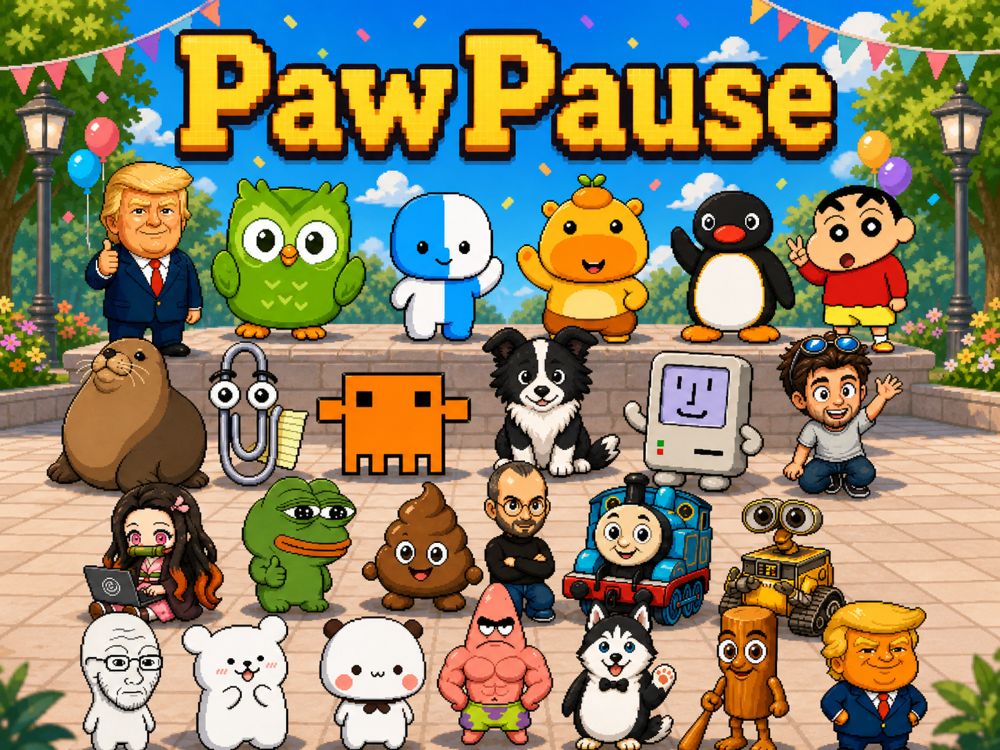

<p align="center">
  
</p>

<h1 align="center">MyPets</h1>

<p align="center">
  <a href="../../README.md">English</a> 路
  <a href="README.zh-CN.md">涓枃</a> 路
  <a href="README.ja.md">鏃ユ湰瑾?/a> 路
  <a href="README.ko.md">頃滉淡鞏?/a> 路
  <a href="README.fr.md">Fran莽ais</a> 路
  <a href="README.de.md">Deutsch</a> 路
  <a href="README.ru.md">袪褍褋褋泻懈泄</a> 路
  <a href="README.ar.md">丕賱毓乇亘賷丞</a> 路
  <a href="README.es.md">Espa帽ol</a>
</p>

MyPets est un compagnon de bureau pixel art pour macOS et Windows. Il reste sur ton 茅cran, te rappelle de faire des pauses et de boire de l'eau, prot猫ge tes sessions de concentration et prend en charge les personnages au format PetDex.

Il est local-first : les r茅glages, statistiques, compagnons import茅s et historique de concentration restent sur ta machine.

## Fonctionnalit茅s

- Compagnon pixel transparent, toujours au premier plan et d茅pla莽able
- Rappels de pause et mode optionnel de blocage d'茅cran
- Rappels d'hydratation avec statistiques historiques
- Rappels quotidiens personnalis茅s avec compte 脿 rebours configurable et agrandissement optionnel du compagnon 脿 l'alerte
- D茅tection des distractions sur macOS par app ou mot-cl茅
- Alertes locales Codex / Claude Code / OpenCode / DeepSeek TUI / Hermes quand une session se termine ou demande une revue
- Import de paquets `pet.json + spritesheet.webp/png`
- Lecture automatique des personnages PetDex dans `~/.codex/pets`
- Interface en 9 langues et mode sombre syst猫me

## Installation

T茅l茅charge les installateurs depuis [Releases](https://github.com/angziii/MyPets/releases).

| Fichier | Plateforme |
| --- | --- |
| `MyPets-x.x.x-mac-arm64.dmg` | macOS Apple Silicon |
| `MyPets-x.x.x-mac-x64.dmg` | macOS Intel |
| `MyPets-x.x.x-win-x64.exe` | Windows 64-bit |

## Hermes (WSL) 鈫?MyPets (Windows)

Si Hermes tourne dans WSL et MyPets tourne sous Windows, Hermes doit 茅crire ses 茅v茅nements dans un chemin lisible par l'application Windows. Le hook Hermes r茅cent le fait automatiquement, mais si les notifications n'apparaissent toujours pas, fixe le chemin directement dans le plugin WSL.

```bash
nano ~/.hermes/plugins/mypets-agent-hook/__init__.py
```

Remplace toute la fonction `_output_file()` par :

```python
def _output_file() -> Path:
    # WSL -> Windows MyPets fallback.
    return Path("/mnt/c/Users/Administrator/.local/share/mypets/agent-events/hermes.jsonl")
```

Si le nom d'utilisateur Windows n'est pas `Administrator`, remplace cette partie par le vrai nom. Puis ex茅cute dans WSL :

```bash
mkdir -p /mnt/c/Users/Administrator/.local/share/mypets/agent-events
```

Red茅marre ensuite Hermes.

## Lancer depuis les sources

```bash
git clone https://github.com/angziii/MyPets.git
cd MyPets
corepack enable
corepack pnpm install
corepack pnpm dev
```

Les gros packs de personnages ne sont pas inclus afin de garder le d茅p么t l茅ger. Importe-les localement ou installe-les avec PetDex.
